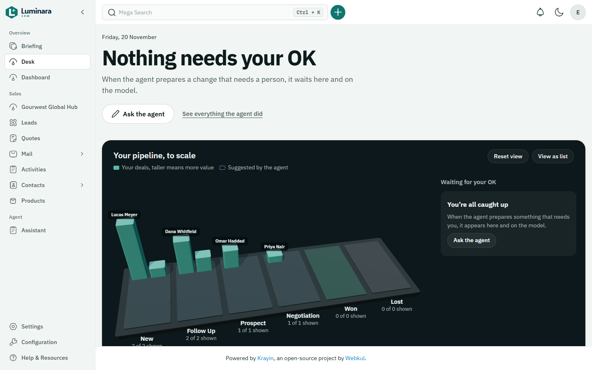
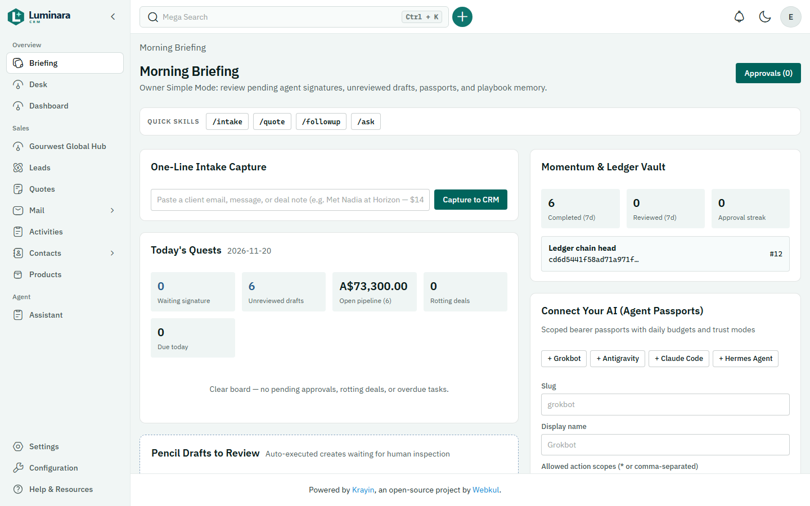
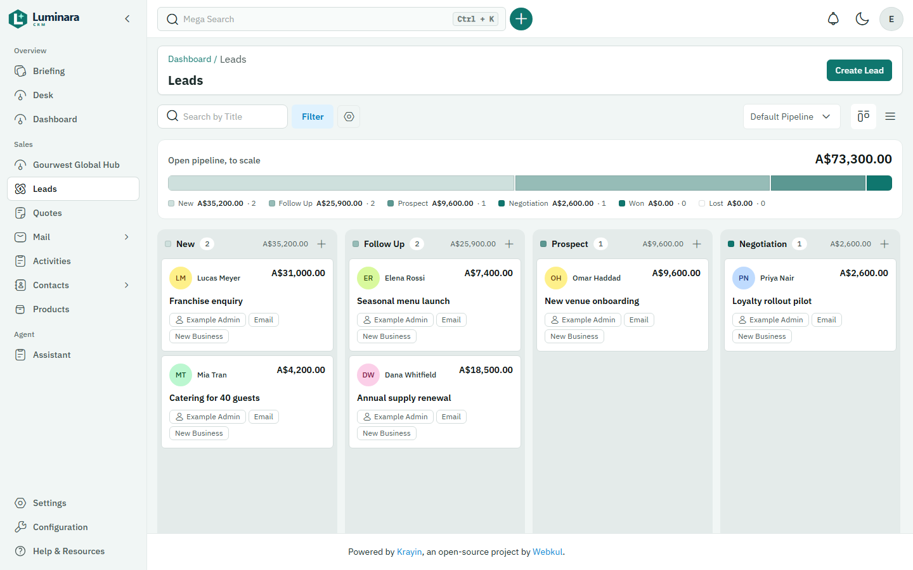

# Luminara CRM

Luminara CRM is an open-source CRM built on [Krayin CRM](https://github.com/krayin/laravel-crm) (Laravel 12, PHP 8.3). It adds an AI agent that works in the CRM as a real user, with that user's permissions, and has to ask before it does anything you can't take back.



- **The agent asks first.** Reads run straight away. Creating a lead, contact, note, or standard quote runs as an unreviewed pencil draft with a signed receipt until a person marks it reviewed. Moving several leads, merging contacts, discounting a quote past 15%, or deleting a record waits for a person with the approval permission. Before an approved call runs, the CRM checks that the records haven't changed since the agent asked. Calls nobody decides expire after 72 hours.
- **Morning Briefing (`Briefing`)** gives business owners a plain-English daily cockpit: one-line deal/note intake capture, waiting signatures, unreviewed pencil drafts, 1-click **Agent Passports** (Grokbot, Antigravity, Claude Code, Hermes Agent), and editable **Business Playbook Memory**.
- **The Desk** (`Desk` in the sidebar) shows what's waiting for your OK beside a 3D model of your pipeline. You can approve or reject there, drag deals between stages with Undo, and see what the agent did today. Phones and devices without WebGL get stage bars instead.
- **The Assistant** lets people ask in plain words with live **Stop** cancellation. It works through the same 26 actions and approvals, and says up front that it is an AI model and which one.
- **Agents from outside** connect through scoped **Agent Passports** over REST (`/api/agent`), Model Context Protocol v2 (`/api/agent/mcp` — tools, resources, and prompts), CLI (`luminara:act --json`), signed webhooks, and `/llms.txt` + `/.well-known/agent.json` discovery manifests, with savepoint `dry_run` previews.
- **Verifiable Data Vault & Telegram Mini App**: Every CRM change and settled agent call mints an append-only, Ed25519/ES256-signed Data Block (`LUM-<ULID>` receipt at `/receipts/{code}`) sealed into hourly RFC 6962 Merkle Epochs (`Webkul\Ledger`), and paired owners can review, capture notes, and sign approvals with WebAuthn biometric Passkeys in Telegram (`/tma`, `Webkul\Tma`).
- **Security hardening**: TOTP two-factor login, login lockout, an append-only audit log, encrypted secrets in settings, signed backups, and a production mode that refuses to start with debug on or the default password.
- **A/B experiments and lead scoring** under Settings > Other Settings > A/B Experiments.

Everything else (leads, contacts, quotes, products, email, web forms, automation) is Krayin's, in 10 languages.

| Morning Briefing | Leads board |
| --- | --- |
|  |  |

## What gets sent to an AI service

Nothing, until you configure one.

- **The Assistant** uses the Anthropic Messages API, or another compatible service you set with `LUMINARA_ASSISTANT_BASE_URL`. When someone uses it, the CRM records that person can read are sent to that service so it can answer them.
- **Krayin's MagicAI** (turned on under Settings > Configuration) sends the files and text you ask it to read to OpenRouter, which passes them to the model you pick.

Check that this fits your privacy obligations before you turn either on.

## Run it locally

You need Docker Desktop with Compose.

```bash
git clone https://github.com/TCWuraGroupCapital/Luminara-CRM.git
cd Luminara-CRM
docker compose up --build -d
```

The first start installs the database, which takes a few minutes. Watch it with `docker compose logs -f app`, then open http://127.0.0.1:8080/admin/login and sign in as `admin@example.com` with the password `admin123`.

The development setup only listens on `127.0.0.1`. Don't expose it to a network.

Settings go in a `.env` file next to `compose.yaml`, which Compose reads when it starts the containers. For example `APP_PORT=8090` changes the port, and `APP_TIMEZONE` and `APP_CURRENCY` change the defaults (Australia/Melbourne, AUD). Run `docker compose up -d` again after changing it.

### Turn on the Assistant

Bring your own Anthropic API key. Either sign in as an admin and paste it under **Settings > Configuration > AI Assistant** (stored encrypted, no restart needed), or add it to `.env` and run `docker compose up -d`:

```bash
LUMINARA_ASSISTANT_API_KEY=your-key
```

A key in `.env` wins. The model and API address then also come from `.env`, and the settings screen is ignored. The Telegram Mini App works the same way: enter your own bot's token, username and webhook secret under **Settings > Configuration > Telegram**, or set the `TELEGRAM_*` values in `.env`.

Admins get every permission. For other roles, tick **Briefing**, **Desk**, **Assistant** and **Agent Approvals** under Settings > Roles.

### Connect an outside agent

Issue a scoped **Agent Passport** from **Briefing** (`/admin/agent/briefing`) or from the CLI:

```bash
docker compose exec app php artisan luminara:passport admin@example.com claude-code --scopes="*" --daily-limit=1500
docker compose exec app php artisan luminara:act briefing_today --as=admin@example.com --passport=claude-code --json
```

Send the bearer token to `/api/agent` or `/api/agent/mcp` (add `X-Luminara-Dry-Run: 1` to preview any action inside a database savepoint without persisting changes). Machine-readable discovery manifests live at `/llms.txt` and `/.well-known/agent.json`. [docs/agents.md](docs/agents.md) walks through connecting Claude Code, Antigravity, Grokbot or any other agent, and what the agent will and won't be allowed to do.

## Run it in production

`compose.prod.yaml` runs the web app, a queue worker, the scheduler, MySQL 8, Redis and an optional Cloudflare Tunnel.

1. Create `.env` next to `compose.prod.yaml` with at least `APP_KEY`, `APP_URL` (https), `DB_PASSWORD`, `MYSQL_ROOT_PASSWORD` and `REDIS_PASSWORD`. Compose refuses to start without them.
2. Start it with `docker compose -f compose.prod.yaml up -d --build`.
3. Run `docker compose -f compose.prod.yaml exec app php artisan luminara:provision` and give it an admin password of at least 12 characters.

Two-factor login is required for admins by default in production.

The full runbook is in [docs/deployment-cloudflare-github.md](docs/deployment-cloudflare-github.md).

## Known limits

- The Desk loads three.js 0.160.0 from jsDelivr. If you set a Content-Security-Policy that blocks it, or run offline, the Desk falls back to stage bars.
- `Webkul\Gourwest` is a worked example: a multi-country customer hub written for a fictional hospitality group, with its own demo seeder (`luminara:seed-gourwest`). You can ignore it. Removing it means taking its providers out of `bootstrap/providers.php` and `config/concord.php`.

## Develop

```bash
docker compose exec app php artisan test --compact
# Tests run against a separate database, luminara_crm_test. On a fresh environment
# create it as a schema-identical clone of luminara_crm first; never point tests
# at a database whose data you want to keep.
docker compose exec app ./vendor/bin/pint
docker compose exec app ./vendor/bin/phpstan analyse --memory-limit=2G
npm run test:js
```

New code goes in a package under `packages/Webkul/`, and every change adds a line to [CHANGELOG.md](CHANGELOG.md). [AGENTS.md](AGENTS.md) has the conventions, and the design rules for the agent screens are in [docs/design.md](docs/design.md).

Report security problems privately, as described in [SECURITY.md](SECURITY.md).

## Licence

MIT, see [LICENSE](LICENSE). Luminara CRM is a fork of Krayin CRM by Webkul, also MIT. Webkul's copyright notice and the `Webkul\*` namespaces are kept. "Krayin" is Webkul's name; this project isn't made or endorsed by Webkul.

Dependencies installed by Composer and npm keep their own licences. A few are GPL or LGPL (for example `mpdf/mpdf` and `dompdf/dompdf`, used for PDF quotes). They aren't stored in this repository, but if you ship a build or image that includes them, their terms apply to it.
